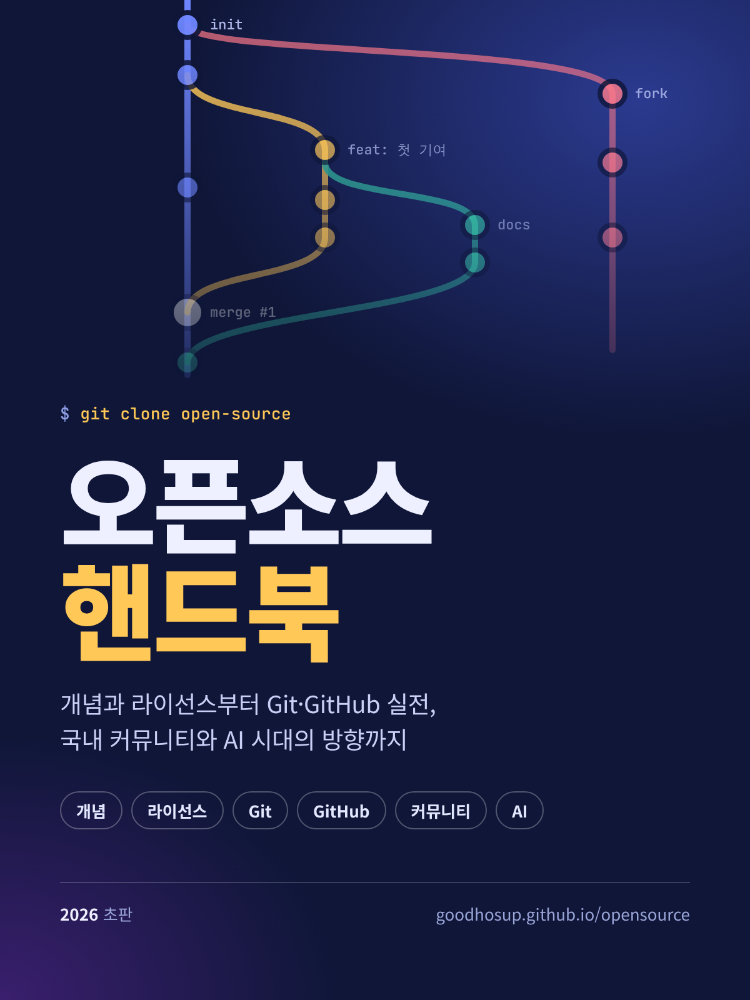

# 오픈소스 핸드북

{ width="320" align=right }

**오픈소스의 개념과 라이선스부터 Git·GitHub 실전 사용법, 국내 정책과 커뮤니티, AI 시대의 향후 방향까지** 한 권으로 정리한 한글 안내서입니다.

처음 오픈소스를 접하는 학생과 개발자는 1부부터 차례로, 바로 기여를 시작하고 싶은 사람은 3·4부부터 읽어도 됩니다.

## 구성
| 부 | 내용 |
|---|---|
| [한눈에 보기](summary.md) | 책 전체 요약 |
| [1부. 오픈소스의 개념](concepts/index.md) | 정의와 원칙, 역사, 자유 소프트웨어와의 차이, 주요 용어, 장점과 한계 |
| [2부. 라이선스](license/index.md) | 라이선스 분류와 의무, 호환성, 소스 어베일러블, 실무 체크리스트 |
| [3부. Git 사용법](git/index.md) | 설치와 설정, 기본 명령, 브랜치, 원격 저장소, 되돌리기, 고급 기능, 요약표 |
| [4부. GitHub 운용 방법](github/index.md) | 기여 워크플로, 이슈·PR·리뷰, 저장소 운영, Actions, Pages, 보안, GitHub CLI |
| [5부. 생태계와 커뮤니티](ecosystem/index.md) | 재단과 프로젝트, 비즈니스 모델, 국내 대회·행사·커뮤니티 |
| [6부. 향후 방향](future/index.md) | 보안과 공급망, 지속가능성, 정책, AI가 미치는 영향 |
| [부록](appendix/index.md) | 국내 정책·지원 사이트와 참고 자료 |

!!! note "기준일과 출처"
    정책·행사·통계 정보는 **2026년 10월 25일** 기준으로 확인했고, 각 페이지에 출처를 달았습니다. 일정과 지원 조건은 해마다 바뀌므로 신청 전 공식 사이트를 다시 확인하세요.

!!! tip "법률 자문이 아닙니다"
    라이선스 설명은 이해를 돕기 위한 일반 정보입니다. 실제 제품의 라이선스 준수 여부는 사내 법무나 전문가, 한국저작권위원회의 무료 검증 서비스로 확인하세요.
